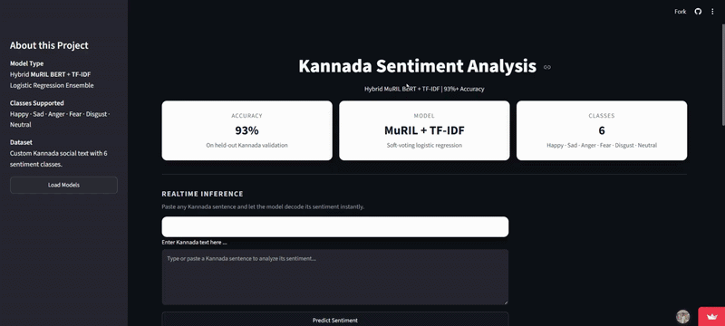
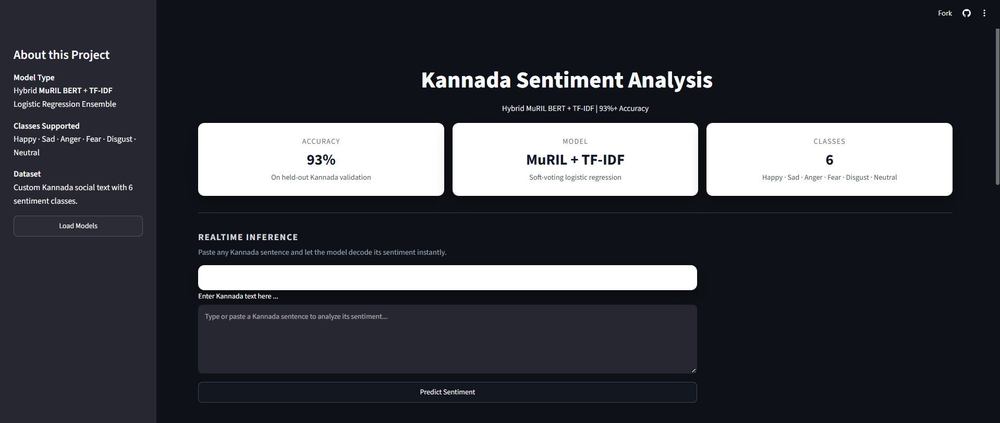
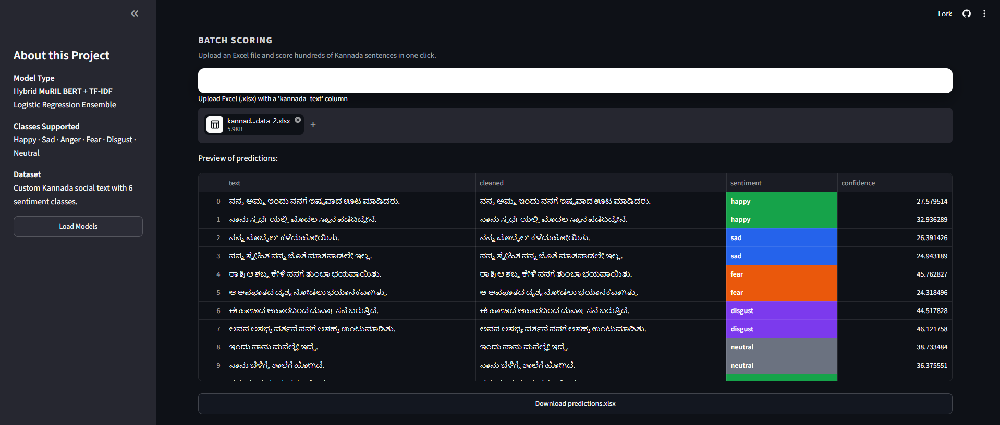
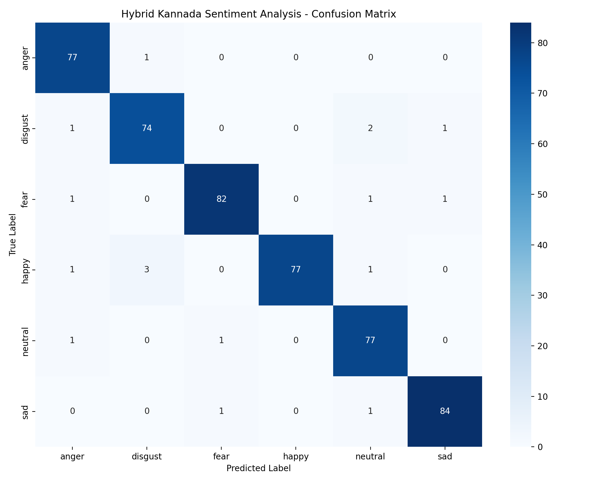

# KannadaSentiment – Hybrid MuRIL + TF-IDF Kannada Emotion Detection


> 🚀 A hybrid MuRIL + TF-IDF based emotion detection system for Kannada text,
> capable of classifying six emotions (happy, sad, anger, fear, disgust, neutral)
> through an interactive Streamlit web interface.

KannadaSentiment is an end-to-end emotion detection system for Kannada text.
It combines modern transformer-based language understanding with classical
machine learning to accurately classify six human emotions from natural language input.

---

## Why This Project?

Most sentiment analysis systems focus on English or simple positive/negative classification. This project explores emotion-aware sentiment analysis (emotion detection) for Kannada using a hybrid transformer + traditional machine learning approach, making it suitable for low-resource Indian language NLP tasks.

---

## Live Demo

🔗 Try the live demo here:  
[kannada-sentiment-analysis.streamlit.app](https://kannada-sentiment-analysis.streamlit.app/)

Simply type a Kannada sentence or upload an Excel file with a `kannada_text` column to test the model.

---

## Quick Start

```bash
git clone https://github.com/adarsh24228-sys/Kannada-Sentiment-Analysis-Model.git
cd Kannada-Sentiment-Analysis-Model
pip install -r requirements.txt
python train.py
streamlit run app/dashboard.py
```



*Real-time emotion prediction and batch Excel inference using the Streamlit dashboard.*

---

## Example Usage

**Input:**
> ನಾನು ಇಂದು ತುಂಬಾ ಸಂತೋಷವಾಗಿದ್ದೇನೆ. *(I am very happy today.)*

**Output:**
*   **Emotion**: `happy`
*   **Confidence**: `94.7%`

---

## Key Features

- 🚀 Real-time Kannada emotion prediction through an interactive Streamlit web app.
- 🤖 Hybrid MuRIL + TF-IDF ensemble architecture.
- 📊 Batch prediction from Excel files with prediction downloads.
- 📈 Training pipeline with evaluation metrics and confusion matrix generation.
- 📄 Automatic PDF report generation.
- 💾 Git LFS support for large trained model artifacts.

---

## Project Structure

- `agents/`
  - `data_agent.py` – loads and cleans the Kannada Excel dataset.
  - `feature_agent.py` – builds TF‑IDF and MuRIL embeddings.
  - `training_agent.py` – trains and saves the TF‑IDF and MuRIL classifiers.
  - `evaluation_agent.py` – evaluates models, generates metrics and confusion matrix.
  - `prediction_agent.py` – loads saved models and runs inference.
  - `orchestrator_agent.py` – orchestrates the full training and prediction pipelines.
- `app/dashboard.py` – Streamlit dashboard for real-time and batch predictions.
- `train.py` – command-line entry point for training.
- `predict.py` – standalone script for quick terminal-based predictions.
- `generate_report.py` – generates a multi-page PDF report in `artifacts/`.
- `requirements.txt` – Python dependencies required to run the project.
- `artifacts/` – evaluation outputs (`confusion_matrix.png`, `classification_report.csv`, `sentiment_report.pdf`).
- `models/` – saved model artifacts (`*.pkl`, tracked via Git LFS).
- `assets/` – screenshots and preview visual assets.

---

## Prerequisites

- Python **3.10** or newer
- Git
- Git LFS *(required only if you want to download or version-control the trained model artifacts)*

**Recommended Hardware:**
- 8 GB RAM minimum
- 16 GB RAM preferred for local MuRIL embedding extraction

---

## Setup & Installation

From the `KannadaSentiment/` directory:

1. **Create and activate a virtual environment** (optional but recommended):

   ```bash
   python -m venv .venv
   # Windows
   .venv\Scripts\activate
   # macOS / Linux
   source .venv/bin/activate
   ```

2. **Install Python dependencies**:

   ```bash
   pip install -r requirements.txt
   ```

---

## Running the Training Pipeline

Place your training dataset in the project root as `dataset.xlsx`.

**Expected dataset format:**

| kannada_text | sentiment |
| :--- | :--- |
| ನಾನು ಸಂತೋಷವಾಗಿದ್ದೇನೆ | happy |
| ನನಗೆ ದುಃಖವಾಗಿದೆ | sad |

Then run the training entrypoint:

```bash
python train.py
```

This will:
- Clean and preprocess the dataset.
- Extract TF‑IDF and MuRIL features.
- Train the TF‑IDF and MuRIL classifiers.
- Evaluate using a weighted ensemble (35% TF‑IDF, 65% MuRIL).
- Save models and supporting artifacts.

The script prints the final **accuracy** and **macro F1** on the test set, alongside 5‑fold cross‑validation scores for both models.

---

## Running the Streamlit Dashboard

After training (so that the `models/` directory is populated), start the UI:

```bash
streamlit run app/dashboard.py
```

Once started, the dashboard will be available at:  
[http://localhost:8501](http://localhost:8501)

> ⚡ **Note:** On the first run, the MuRIL model will be downloaded automatically. This may take a minute depending on your internet connection.

### Batch Predictions Details
The uploaded Excel file should contain at least one column named `kannada_text`. Additional columns are preserved in the output prediction file.

---

## Quick CLI Predictions

For quick testing without launching the browser, you can run inference on a set of sample test sentences in your terminal:

```bash
python predict.py
```

This script loads the saved models from `models/` and runs inference on a set of predefined Kannada test sentences directly in the terminal.

---

## Dashboard Preview

### Real-Time Prediction


### Batch Excel Prediction


### Confusion Matrix Heatmap


---

## Results & Performance

The hybrid ensemble model achieved the following performance on our held-out test dataset:

- Accuracy: **96.52%**
- Macro F1-score: **0.9652**
- Evaluation strategy: **80/20 train-test split with 5-fold cross-validation during model development.**

The final prediction is obtained by combining the probabilities from both models using a weighted soft-voting ensemble (35% TF-IDF + 65% MuRIL). The confidence score displayed is calculated from these weighted ensemble probabilities.

### Dataset Summary

- Total samples: **2440**
- Emotion classes: **6**
- Labels: `happy`, `sad`, `anger`, `fear`, `disgust`, `neutral`
- Train/Test split: **80/20** (1952 training / 488 testing samples)

### Per-Class Metrics

| Emotion | Precision | Recall | F1-Score | Support |
| :--- | :--- | :--- | :--- | :--- |
| **Anger** | 0.95 | 0.99 | 0.97 | 78 |
| **Disgust** | 0.95 | 0.95 | 0.95 | 78 |
| **Fear** | 0.98 | 0.96 | 0.97 | 85 |
| **Happy** | 1.00 | 0.94 | 0.97 | 82 |
| **Neutral** | 0.94 | 0.97 | 0.96 | 79 |
| **Sad** | 0.98 | 0.98 | 0.98 | 86 |
| **Overall Accuracy** | | | **96.52%** | **488** |

---

## Generating the PDF Report

To build a polished PDF report (useful for academic submissions or project documentation):

```bash
python generate_report.py
```

This creates `artifacts/sentiment_report.pdf` containing a cover page, project overview, system architecture diagram, quantitative metrics, and project conclusions.

---

## Git LFS & Large Model Files

Model artifacts in `models/` are binary `*.pkl` files. This repository uses **Git LFS** to store them efficiently:

- The `.gitattributes` file includes:

  ```gitattributes
  *.pkl filter=lfs diff=lfs merge=lfs -text
  ```

- To push new model commits:

  ```bash
  git add .gitattributes models/*.pkl
  git commit -m "Add trained Kannada sentiment models"
  git push origin main
  ```

---

## Technologies Used

- **Language**: Python 3.10+
- **Deep Learning**: PyTorch, Hugging Face Transformers (MuRIL Model)
- **Traditional ML**: Scikit-Learn (TF-IDF, Logistic Regression)
- **Data Manipulation**: Pandas, OpenPyXL, NumPy, SciPy
- **Data Visualization**: Matplotlib, Seaborn
- **Dashboard & UI**: Streamlit
- **Reporting**: ReportLab (PDF Generation)
- **Model Serialization**: Joblib

---

## Future Work

- Fine-tune MuRIL directly on the Kannada sentiment dataset.
- Add support for code-mixed Kannada-English text.
- Provide REST API endpoints using FastAPI.
- Expand the dataset to additional emotion categories.
- Deploy using Docker for easier portability.
- Expand support to additional Indian languages.

---

## License & Acknowledgements

### License
This project is licensed under the MIT License.

### Acknowledgements
- **MuRIL**: *Multilingual Representations for Indian Languages* (Google Research).
- **Hugging Face**: Transformers ecosystem.
